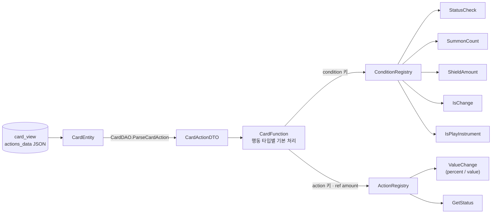
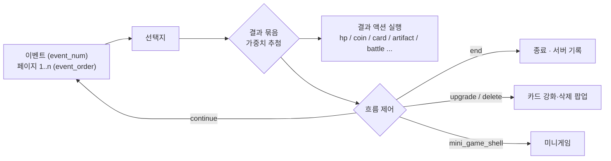

# 코드 하이라이트 (Code Highlights)

> 약 25,000줄의 코드 중 **먼저 보시면 좋은 부분**과, 각 부분에서 **어떤 문제를 어떤 구조로 풀었는지** 정리한 문서입니다.
> 모든 링크는 해당 코드 줄로 바로 이동합니다.

## 한눈에 보기

| # | 주제 | 핵심 | 대표 코드 |
|---|---|---|---|
| 1 | **코드 수정 없이 DB로 만드는 카드** | 카드 효과를 코드가 아니라 DB에 적힌 데이터(행동·대상·수치·발동 조건)로 정의합니다. 발동 조건과 추가 효과는 독립된 부품으로 만들어 두고, DB에 적힌 이름으로 찾아 실행합니다. 카드를 실행하는 코드에는 카드 ID로 나누는 분기가 없습니다. | [`CardFunction.cs`](Scripts/Gameplay/CardSystem/CardFunction/CardFunction.cs#L15-L33), [`Condition/`](Scripts/Gameplay/CardSystem/CardFunction/Condition), [`Action/`](Scripts/Gameplay/CardSystem/CardFunction/Action) |
| 2 | **선택지 시스템 3종** | 콘텐츠 성격에 맞춰 이벤트(가중치 결과 묶음), 적 대화(노드 타입 트리), 메인 스토리를 나눠 설계했습니다. | [`EventDAO.cs`](Scripts/Data/DAOs/DAOs/EventDAO.cs#L83-L140), [`MysteryManager.cs`](Scripts/App/Managers/MysteryManager/MysteryManager.cs#L115), [`EnemyText.cs`](Scripts/Gameplay/Enemies/Enemy/EnemyText.cs#L89) |
| 3 | **절차적 맵 생성 · 시드 결정론** | 노드 수량은 고정하고 배치만 섞습니다. 인접 노드끼리만 연결하고 보정해서 막다른 길이나 도달할 수 없는 노드가 없습니다. 맵, 적, 이벤트를 시드 2개로 재현해서 재접속해도 결과가 같습니다. | [`StageGenerator.cs`](Scripts/Gameplay/Stage/StageMap/StageGenerator.cs#L21), [`EnemyManager.cs`](Scripts/App/Managers/MainBattle/EnemyManager.cs#L103-L139) |
| 4 | **재화별 서버 검증 범위** | 영구 재화와 상점 구매는 상품 ID만 보내고 서버가 가격과 지급을 결정합니다. 한 판 안에서만 쓰는 런 재화는 클라이언트가 계산합니다. 조작됐을 때 다른 유저나 계정에 영향이 남는지를 기준으로 나눴습니다. | [`ShopDetailPopup.cs`](Scripts/App/Managers/PopupManager/ShopDetailPopup.cs#L45-L49), [`MysteryResult.cs`](Scripts/App/Managers/MysteryManager/MysteryResult.cs#L188-L215) |
| 5 | **트리거 기반 유물·패시브** | 트리거 18종과 효과 20종을 데이터로 조합합니다. 전투 코드에는 트리거 호출 지점만 둡니다. | [`ArtifactFunction.cs`](Scripts/App/Managers/ArtifactFunction.cs#L134) |
| 6 | **런타임 기반 구조** | Entity와 DTO를 분리하고 로케일 테이블도 따로 둡니다. 20개 테이블을 병렬로 로딩하고, 싱글톤은 생명주기별로 3종을 씁니다. | [`InGameDataLoadManager.cs`](Scripts/Data/GameData/GameData/InGameDataLoadManager.cs), [`Generics/`](Scripts/Shared/Generics/Generics) |

### 10분 읽기 순서

1. [`CardFunction.cs` L15-33](Scripts/Gameplay/CardSystem/CardFunction/CardFunction.cs#L15-L33): 조건과 액션을 레지스트리에 등록하는 부분
2. [`ShieldAmountCondition.cs`](Scripts/Gameplay/CardSystem/CardFunction/Condition/ShieldAmountCondition.cs): 조건 평가기 하나가 어떻게 생겼는지
3. [`CardFunction.cs` L236-280](Scripts/Gameplay/CardSystem/CardFunction/CardFunction.cs#L236-L280): 공격 카드에 조건→액션이 적용되는 흐름
4. [`EventDAO.cs` L83-140](Scripts/Data/DAOs/DAOs/EventDAO.cs#L83-L140): 이벤트 결과 묶음과 가중치 추첨
5. [`EnemyText.cs` L89-155](Scripts/Gameplay/Enemies/Enemy/EnemyText.cs#L89-L155): 대화 노드 타입별 처리
6. [`StageGenerator.cs`](Scripts/Gameplay/Stage/StageMap/StageGenerator.cs#L21): 시드 기반 맵 생성과 연결성 보장

---

## 1. 카드 효과: switch-case 대신 데이터와 Condition/Action 레지스트리

### 풀고 싶었던 문제

카드가 늘 때마다 `if (card.Id == 37) { ... }` 같은 분기가 붙으면, 수치 조정이나 카드 추가 하나에도 코드 수정과 빌드가 필요하고 분기도 끝없이 늘어납니다.
그래서 **카드를 코드가 아닌 데이터로 정의**하고, 코드는 그 데이터를 해석하는 역할만 맡도록 했습니다.

### 카드 = 행동(action) 행들의 목록

카드 하나는 DB(`card_view.actions_data`)에 담긴 행동 행 여러 개로 이뤄집니다.

| 필드 | 의미 |
|---|---|
| `order_index` | 실행 순서 |
| `action` | `attack` `shield` `heal` `buff` `debuff` `draw` `repeat` `upgrade` `equip` `action` `get_action_point` |
| `target` | `self` `enemy` `enemys` |
| `value` / `value_upgrade` / `value_upgrade2` | 강화 단계별 수치 (기획자가 강화 밸런스를 데이터로 조정) |
| `effect` | 재생할 이펙트 종류 (오브젝트 풀 키) |
| `extra_data` (JSON) | `condition`, `action`, `percent`, `value`, `probability` 등 수식어 |



- 파싱: [`CardDAO.ParseCardAction`](Scripts/Data/DAOs/DAOs/CardDAO.cs#L27). 문자열을 enum으로 바꾸고, 행 하나가 파싱에 실패해도 그 행만 건너뛰고 로그를 남깁니다.
- 실행: [`CardFunction.CardAbility`](Scripts/Gameplay/CardSystem/CardFunction/CardFunction.cs#L40-L73). `order_index` 순서대로 행을 실행합니다.

### 레지스트리: 문자열 키 → 평가기·실행기

```csharp
// CardFunction.cs
conditionRegistry.Register("status_exist",       new StatusCheckCondition());
conditionRegistry.Register("is_summon",          new SummonCountCondition());
conditionRegistry.Register("shield_amount",      new ShieldAmountCondition());
// ...
actionRegistry.Register("percent",    new ValueChangeAction());
actionRegistry.Register("value",      new ValueChangeAction());
actionRegistry.Register("get_status", new GetStatusAction());
```

```csharp
public interface IConditionEvaluator { bool Evaluate(CardActionDTO cardAction, Player player, GameObject enemy); }
public interface IActionExecutor     { void Execute(CardActionDTO cardAction, ref int amount, CharacterBase target); }
```

액션은 `ref int amount`로 피해량·방어도·회복량을 **파이프라인처럼 변형**합니다. 그래서 같은 `percent` 액션이 공격, 방어, 회복, 드로우 어디서든 그대로 재사용됩니다.

### `extra_data` 예시

파서가 해석하는 형태를 보여드리기 위한 예시입니다.

```jsonc
// 내 방어도가 10 이상이면 피해 2배
{ "condition": { "shield_amount": 10, "op": ">=" }, "action": { "percent": 2 } }

// 대상에게 특정 디버프가 있으면 상태이상 추가 부여
{ "condition": { "status_exist": { "debuff": 3, "target": "enemy" } }, "action": { "get_status": 5 } }

// 피해량 = 현재 내 방어도
{ "value": { "shield_value": "self" } }

// 손패 장수만큼 배율
{ "percent": "hand_count" }
```

### 데이터만으로 표현되는 카드 패턴

| 패턴 | 표현 방법 | 코드 |
|---|---|---|
| 조건부 추가 효과 | `condition` + `action` | [L236-260](Scripts/Gameplay/CardSystem/CardFunction/CardFunction.cs#L236-L260) |
| 조건 불만족 시 아예 발동 안 함 | `condition`만 있고 `action` 없음 | [L251-258](Scripts/Gameplay/CardSystem/CardFunction/CardFunction.cs#L251-L258) |
| 다단 히트 | `attack` 행 바로 뒤에 `repeat` 행. `repeat`에도 조건 가능 (예: 소환수가 있을 때만 N회) | [L120-141](Scripts/Gameplay/CardSystem/CardFunction/CardFunction.cs#L120-L141) |
| 확률형 카드 | 여러 행에 `probability` 가중치. 하나만 추첨해서 실행 | [L76-109](Scripts/Gameplay/CardSystem/CardFunction/CardFunction.cs#L76-L109) |
| 지연 실행 | `late_action`. 다른 행동이 다 끝난 뒤 방어도 적용 | [L448-455](Scripts/Gameplay/CardSystem/CardFunction/CardFunction.cs#L448-L455) |
| 상태 기반 수치 | `value: { status_count / shield_value / summon_count }` | [`ValueChangeAction.cs`](Scripts/Gameplay/CardSystem/CardFunction/Action/ValueChangeAction.cs) |

### 새 조건을 추가할 때 바뀌는 곳

1. `IConditionEvaluator`를 구현한 클래스 하나 추가 (예: `HpBelowCondition`)
2. `conditionRegistry.Register("hp_below", new HpBelowCondition());` 한 줄
3. DB의 `extra_data`에 `"condition": { "hp_below": 30 }` 입력

**기존 카드 코드와 다른 조건 클래스는 건드리지 않습니다.**

### 카드 UI도 같은 데이터에서 만들어집니다

- [`CardDTOToObj.SetDescription`](Scripts/Shared/Utils/Utils/CardDTOToObj.cs#L86): 설명 문구의 `^` 자리에 실제 행동 수치를 넣습니다. 강화나 버프로 값이 원본보다 바뀌면 초록·빨강으로 표시하고, 대상이 나인지 적인지에 따라 유리/불리 색을 반대로 씁니다. 그래서 **설명 문구와 실제 효과가 어긋나지 않습니다.**
- [`CardDTOToObj.SetCardAbilitys`](Scripts/Shared/Utils/Utils/CardDTOToObj.cs#L245): 카드에 들어 있는 상태이상 키워드(`get_status`, `ethereal` 등)를 읽어 키워드 설명 박스를 자동으로 만듭니다.

---

## 2. 선택지 처리: 콘텐츠 성격에 맞춘 3가지 구조

선택지가 나오는 콘텐츠는 세 종류이고, 흐름이 서로 달라 구조도 따로 설계했습니다.
**셋 다 선택지 텍스트는 `*_locales` 테이블(`lan_code`)로 분리**해서, 언어를 추가해도 코드는 바뀌지 않습니다.

### 2-1. 미스터리 이벤트: 여러 페이지 + 가중치 결과 묶음



- **결과 묶음 (chain)**: [`EventDAO.GroupResultBundles`](Scripts/Data/DAOs/DAOs/EventDAO.cs#L83-L126)
  `result_type = chain`인 결과들을 다음 `end`/`continue`까지 하나로 묶습니다. 그래서 "코인 -30 + 유물 획득 + 종료" 같은 **복합 결과를 가중치 후보 하나로** 다룰 수 있습니다.
- **가중치 추첨**: [`GetRandomResultByWeight`](Scripts/Data/DAOs/DAOs/EventDAO.cs#L128-L140)
- **선택 가능 여부 판단**: [`MysteryManager.SetEventSelect`](Scripts/App/Managers/MysteryManager/MysteryManager.cs#L139-L161)
  결과에 코인 소모가 있는데 가진 코인이 부족하거나, `item_exist`로 요구한 유물이 없으면 해당 선택지 버튼을 비활성화합니다.
- **결과 액션 9종**: [`MysteryResult.ResultAction`](Scripts/App/Managers/MysteryManager/MysteryResult.cs#L22)
  `hp_max_get` `hp_get` `artifact_get`(지정 또는 희귀도별 랜덤) `artifact_delete` `card_get` `card_delete` `coin_get`(고정값 또는 비율) `set_next_event` `battle_enemy`
- **연계 이벤트**: `set_next_event`로 다음 미스터리 노드에 나올 이벤트를 고정합니다 ([L72](Scripts/App/Managers/MysteryManager/MysteryManager.cs#L72)). 여러 노드에 걸친 이야기(예: 사또 이벤트)를 데이터로 이어 붙일 수 있습니다.

### 2-2. 적 대화: 노드 타입 기반 대화 트리

보스와의 대화는 노드 타입(`root` `branch` `continue_` `action` `leaf`)으로 흐름을 표현합니다. [`EnemyText.SetTextBox`](Scripts/Gameplay/Enemies/Enemy/EnemyText.cs#L89-L155)

| 노드 | 동작 |
|---|---|
| `root` | 시작 노드. 여러 개면 **스토리 진행 조건**으로 하나를 고릅니다 ([L41-58](Scripts/Gameplay/Enemies/Enemy/EnemyText.cs#L41-L58), [`EnemyTextConditionChecker`](Scripts/Gameplay/Enemies/Enemy/EnemyTextConditionChecker.cs)). 같은 적이라도 이전 선택에 따라 대사가 달라집니다. |
| `branch` | 선택지를 보여주고, 고른 선택지의 `next_index`로 이동 |
| `continue_` | 화면을 터치하면 `text_id` 노드로 이동 |
| `action` | 증거 제시 단계. 가진 스토리 카드를 손패로 꺼내 설득에 씁니다 ([`EnemyTextActionHandler`](Scripts/Gameplay/Enemies/Enemy/EnemyTextActionHandler.cs)). |
| `leaf` | 대화 종료. `is_final`이면 보스전 승리로 처리 |

노드에 들어갈 때의 부수 효과도 `extra_data`로 정의합니다. [`EnemyTextChoiceResult`](Scripts/Gameplay/Enemies/Enemy/EnemyTextChoiceResult.cs)
`get_artifact`, `get_coin`/`lose_coin`(고정값 또는 비율), `spine_change`/`image_change`(적 외형 변경), `arrest_tiger`(스토리 플래그 저장)가 있습니다.
여기서 저장한 **스토리 플래그가 다시 다른 대화의 `root` 선택 조건이 되기 때문에**, 한 번의 선택이 이후 스토리 분기로 이어집니다.

### 2-3. 메인 스토리

[`MainStoryChooseManager`](Scripts/App/Managers/MainStory/MainStoryChooseManager.cs): 선택지 하나가 세 갈래 중 하나로 이어집니다.
- `next_text_id`: 다음 대사로 이동
- `result` 목록: 결과 텍스트를 보여준 뒤 이어서 진행
- `extra_data.scene_move`: 씬 전환

### 2-4. 스토리 카드 사용: 전략 패턴

같은 스토리 카드라도 놓인 씬에 따라 동작이 다릅니다. 적 설득 전투에서는 설득 포인트가 되고, 오누이 집 퍼즐에서는 도끼로 나무를 베거나 우물을 비웁니다.
[`StoryCard`](Scripts/Gameplay/Cards/Cards/StoryCard.cs#L23-L27)는 [`IStoryCardUse`](Scripts/Gameplay/Story/Story/CardUse/IStoryCardUse.cs) 인터페이스만 알고, 어떤 구현([`Battle`](Scripts/Gameplay/Story/Story/CardUse/StoryCardUseBattle.cs) / [`Onu`](Scripts/Gameplay/Story/Story/CardUse/StoryCardUseOnu.cs))이 쓰이는지는 모릅니다.

---

## 3. 절차적 맵 생성과 시드 기반 결정론

### 맵 구조

스테이지 하나는 두 막으로 나뉩니다.

```text
시작 ─ [일반 층 ×9] ─ 휴식 ─ 엘리트 ─ [일반 층 ×9] ─ 휴식 ─ 보스
```

막마다 전투 13, 미스터리 7, 상점 2, 유물 2개, 모두 24개 노드를 9개 층에 나눠 놓습니다. 그래서 일반 층에는 노드가 2~3개씩 들어갑니다.
마지막 스테이지는 고정 시드로 "휴식 노드 3개 → 보스" 맵을 만듭니다 ([`StageManager` L58-65](Scripts/Gameplay/Stage/StageMap/StageManager.cs#L58-L65)).

### 생성 알고리즘: [`StageGenerator.Generate`](Scripts/Gameplay/Stage/StageMap/StageGenerator.cs#L21)

| 단계 | 내용 | 코드 |
|---|---|---|
| 1. 타입 풀 셔플 | 정해진 수량만큼 노드 타입 목록을 만들고 시드로 섞습니다. **노드 종류별 개수는 매번 같고 위치만 바뀌어서** 판마다 밸런스 편차가 생기지 않습니다. | [L28](Scripts/Gameplay/Stage/StageMap/StageGenerator.cs#L28) |
| 2. 층별 노드 수 | 층마다 균등하게 나누고, 나머지는 무작위 층에 1개씩 더합니다. | [L37-48](Scripts/Gameplay/Stage/StageMap/StageGenerator.cs#L37-L48) |
| 3. 고정 층 삽입 | 막 끝에 휴식 층을 넣고, 전반부에는 엘리트, 후반부에는 보스 층을 넣습니다. | [L68-130](Scripts/Gameplay/Stage/StageMap/StageGenerator.cs#L68-L130) |
| 4. 간선 연결 | 양 끝 노드는 다음 층의 양 끝 노드와 연결합니다. 중간 노드는 다음 층의 인접 노드(i-1, i, i+1) 중 1~3개와만 연결해서, 멀리 떨어진 노드끼리 이어지지 않습니다. | [L137-170](Scripts/Gameplay/Stage/StageMap/StageGenerator.cs#L137-L170) |
| 5. 연결성 보정 | 들어오는 간선이 없는 노드에는 아래 층의 인접 노드에서 간선 1~2개를 추가합니다. | [L172](Scripts/Gameplay/Stage/StageMap/StageGenerator.cs#L172) |
| 6. 정렬 · 시작 노드 | 다음 노드 목록을 인덱스 순으로 정렬해 선을 그리는 순서를 고정합니다. 시작 노드는 첫 층의 모든 노드와 연결합니다. | [L201](Scripts/Gameplay/Stage/StageMap/StageGenerator.cs#L201), [L206](Scripts/Gameplay/Stage/StageMap/StageGenerator.cs#L206) |

4~5단계 덕분에 **모든 노드에 나가는 간선과 들어오는 간선이 하나 이상** 있습니다. 즉 막다른 길이나 도달할 수 없는 노드가 생기지 않습니다.

### 시드로 정해지는 것들

로그라이크라서 **앱을 껐다 켜서 결과를 다시 뽑는 것**(세이브 스커밍)을 막아야 했습니다.
그래서 랜덤 요소를 모두 시나리오 DB에 저장된 시드 2개(`mapSeed`, `generateSeed`)로 정합니다.

| 대상 | 방식 | 코드 |
|---|---|---|
| 맵 구조 | `mapSeed`로 생성. 맵 전체를 저장하지 않고 시드만 저장한 뒤 접속할 때 다시 만듭니다. | [`StageManager` L58-65](Scripts/Gameplay/Stage/StageMap/StageManager.cs#L58-L65) |
| 적 조우 순서 | `generateSeed`로 스테이지의 적 목록을 Fisher-Yates 셔플하고, 전투 횟수 순서대로 꺼냅니다. | [`EnemyManager` L103-139](Scripts/App/Managers/MainBattle/EnemyManager.cs#L103-L139) |
| 이벤트 순서 | `generateSeed`로 이벤트 목록을 섞습니다. | [`SetMysteryListBySeed`](Scripts/App/Managers/MysteryManager/MysteryManager.cs#L32) |
| 이벤트의 랜덤 대상 | `generateSeed + 지금까지의 선택 횟수`로 난수를 만듭니다 (유물·카드 랜덤 삭제 등). | [`MysteryResult` L27](Scripts/App/Managers/MysteryManager/MysteryResult.cs#L27) |

다시 접속해도 같은 맵, 같은 적, 같은 결과가 나오고, 저장하는 값은 정수 2개뿐입니다.

---

## 4. 재화 성격에 따라 나눈 서버 검증 범위

전투는 클라이언트에서만 진행되고, 턴마다 어떤 카드를 냈는지 같은 전투 과정은 서버에 저장하지 않습니다.
서버가 전투 보상을 검증하려면 이 과정을 모두 기록하거나 서버에서 전투를 다시 돌려야 하는데, 저장량과 구현 비용이 너무 컸습니다.
그래서 **"조작됐을 때 다른 유저에게 영향이 가는가, 계정에 영구히 남는가"**를 기준으로 서버가 맡을 범위를 나눴습니다. 계정에 남는 값은 서버가 결정하고, 한 판 안에서만 쓰이는 값은 클라이언트가 계산한 결과를 기록하도록 열어 두었습니다(트레이드오프).

| 구분 | 예 | 처리 방식 | 코드 |
|---|---|---|---|
| **영구 재화 · 상점 구매** | 업적·광고 포인트로 사는 카드 프레임, 꾸미기, 캐릭터 | 계정에 영구히 남는 값이라 **서버가 결정**합니다. 클라이언트는 상품 ID나 업적 ID만 보내고, 가격 차감·보상 지급·소유 처리는 서버 RPC가 합니다. | [`buy_product`](Scripts/App/Managers/PopupManager/ShopDetailPopup.cs#L45-L49), [`user_clear_check_achieve_rpc`](Scripts/App/Managers/AchieveManager.cs#L223-L226) |
| **이벤트 결과** | 미스터리 이벤트의 코인·체력 증감 | 결과 데이터가 DB에 있어서, 클라이언트는 결과 ID만 보내고 **증감 수치는 서버가 DB에서 조회**합니다. | [`MysteryResult`](Scripts/App/Managers/MysteryManager/MysteryResult.cs#L188-L215) |
| **런 재화** | 한 판 안의 코인, 체력 | 판이 끝나면 초기화되고 랭킹이나 PvP처럼 다른 유저와 비교하는 요소가 없습니다. 그래서 **금액을 클라이언트가 계산해 서버에 기록**합니다. 조작돼도 다른 유저에게는 영향이 없습니다. | [`SupabaseGetScenarioCoin`](Scripts/Services/Supabase/Supabase/SupabaseGetScenarioCoin.cs#L17-L19) |

공통 규칙도 있습니다.
- **로컬 상태는 서버가 성공을 응답한 뒤에만 바꿉니다.** 통신이 실패하면 화면의 값과 서버의 값이 어긋나지 않게 아무것도 바꾸지 않습니다.
- **선택 기록**: 이벤트 선택과 클리어 횟수를 서버에 기록해서(`AddScenarioSelectList`, `IncreaseClearCount`) 같은 노드에 다시 들어가 다른 선택을 할 수 없습니다.
- **공통 호출 래퍼**: [`SupabaseWrap.ExecuteWithRefresh`](Scripts/Services/Supabase/Supabase/SupabaseWrap.cs#L10)
  JWT가 만료되면 토큰을 갱신하고 한 번 재시도합니다. 갱신에 실패하면 시작 화면으로 돌려보냅니다. 모든 RPC가 이 래퍼를 거치므로 세션 처리가 한곳에 모여 있습니다.

---

## 5. 트리거 기반 유물 · 적 패시브

- 유물 하나는 `(트리거, 효과 타입, 대상, 값, extra_data)` 데이터 조합입니다.
  트리거([`ArtifactTriggerType`](Scripts/Shared/Utils/Utils/EnumType.cs#L38) 18종)는 `on_battle_start`, `on_first_card_attack`, `on_get_damage_first`, `on_kill_enemy`, `on_shop_enter` 등이고, 효과([`ArtifaceEffectType`](Scripts/Shared/Utils/Utils/EnumType.cs#L44) 20종)와 조합합니다.
- 전투 코드에는 **"지금 이 시점이다"라는 트리거 호출만** 둡니다 (예: 공격 직전 [`ArtifactAttackEnemyFirst`](Scripts/Gameplay/CardSystem/CardFunction/CardFunction.cs#L229)).
  [`ProcessArtifactEffects`](Scripts/App/Managers/ArtifactFunction.cs#L134-L311)는 해당 트리거에 걸린 효과만 실행하고, 결과를 `DamageReceiveResult`(피해 무효, 배율, 부활, 저주 차단)로 돌려줍니다. **호출하는 쪽은 결과 객체만 해석하면 됩니다.**
- 적 패시브도 같은 방식입니다 ([`PassiveFunction`](Scripts/Gameplay/Battle/Battle/PassiveFunction.cs#L13), `EnemyPassiveTrigger` 6종).

---

## 6. 런타임 기반 구조

| 항목 | 내용 | 코드 |
|---|---|---|
| Entity / DTO 분리 | Supabase 어트리뷰트는 Entity에만 붙이고, 게임 로직은 DTO만 다룹니다. 백엔드를 바꿔도 DAO 계층만 바뀝니다. | [`Entities/`](Scripts/Data/Entities/Entities), [`DTOs/`](Scripts/Data/DTOs/DTOs), [`DAOs/`](Scripts/Data/DAOs/DAOs) |
| 병렬 로딩 | 기획 데이터 20개 테이블을 `Task.WhenAll`로 동시에 불러옵니다. | [`InGameDataLoadManager`](Scripts/Data/GameData/GameData/InGameDataLoadManager.cs) |
| 생명주기별 싱글톤 | `Singleton<T>`(순수 C#: DAO·서비스), `SceneSingleton<T>`(씬 한정 매니저), `MonoBehaviorSingleton<T>`(`DontDestroyOnLoad` 전역) | [`Generics/`](Scripts/Shared/Generics/Generics) |
| 오브젝트 풀 | 이펙트 타입별 큐를 두고, 로딩 시점에 미리 만들어 재사용합니다. | [`EffectPoolManager`](Scripts/App/Managers/EffectPoolManager.cs) |
| 커맨드 패턴 | 클릭과 드래그를 구분하는 로직(누른 위치와 뗀 위치 비교)은 베이스 클래스에 두고, 팝업 종류별로 `Execute`만 구현합니다. | [`ClickCommand`](Scripts/UI/Controls/ClickControl/ClickCommand.cs) |

---

## 7. 한계와 다음 단계

직접 짚어 본 개선점입니다.

- **기본 행동의 분기**: [`AbilityFunction`](Scripts/Gameplay/CardSystem/CardFunction/CardFunction.cs#L111-L221)은 기본 행동 12종을 아직 `switch`로 나눕니다. 조건과 수식어는 레지스트리로 옮겼으니, 행동 자체도 등록형으로 바꾸면 `CardFunction`에는 실행 순서 관리만 남습니다.
- **문자열 키의 위험**: `extra_data`가 `Dictionary<string, object>`이고 키가 문자열이라 오타가 런타임에야 드러납니다. 로딩 시점에 스키마를 검증하거나(모르는 키, 등록되지 않은 condition 키를 경고), 파싱 단계에서 타입이 있는 객체로 바꾸는 것이 다음 단계입니다.
- **수치 계산의 if 체인**: [`ValueChangeAction`](Scripts/Gameplay/CardSystem/CardFunction/Action/ValueChangeAction.cs) 안은 여전히 키별 if 체인입니다. 손패 수, 소환수 수, 방어도 같은 "기준값 공급자"를 별도 레지스트리로 뺄 수 있습니다.
- **단일 조건**: 조건은 지금 키 하나만 평가합니다(`Properties().First()`). AND/OR 조합이 필요해지면 복합 조건 평가기를 추가할 계획입니다.
- **결과 처리의 통일**: 이벤트와 적 대화의 결과 처리([`MysteryResult`](Scripts/App/Managers/MysteryManager/MysteryResult.cs), [`EnemyTextChoiceResult`](Scripts/Gameplay/Enemies/Enemy/EnemyTextChoiceResult.cs))는 아직 `switch`/`if` 방식입니다. 카드에서 검증한 레지스트리 구조로 맞출 수 있습니다.
- **테스트 격리**: 매니저끼리 싱글톤 `Instance`를 직접 참조해서 단위 테스트로 떼어내기 어렵습니다. 의존성 주입으로 바꿔 갈 계획입니다.
- **업적 진행도 보고**: 업적 진행도(전투 횟수, 코인 사용량 등)는 클라이언트가 값을 보고합니다([`SupabaseAchieve`](Scripts/Services/Supabase/Supabase/SupabaseAchieve.cs#L12-L16)). 그래서 런 재화를 조작하면 업적을 거쳐 영구 재화까지 번질 수 있는 경로가 남아 있습니다. 진행도를 서버 쪽 기록(전투 결과, 이벤트 결과)에서 직접 집계하는 것이 다음 단계입니다.
- **런 재화의 서버 계산**: 전투 보상과 상점 가격도 금액 대신 "노드 번호", "상품 ID"를 보내고 서버가 계산하도록 바꿀 수 있습니다. 이벤트 결과에서 이미 쓰고 있는 방식입니다.
